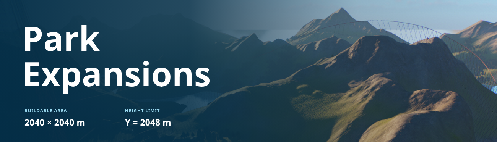

# Park Expansions

Expand your park through two research branches: park size and building height. Each branch has five upgrades.

- Buildable area up to **2040 × 2040 m**, within a 2048 × 2048 m terrain volume.
- Building ceiling up to **world Y = 2048 m**. Individual ride limits may differ.
- Original landscape retained, with surrounding landscape made editable.
- Automatic conversion of supported existing local Sandbox and Challenge parks.
- Optional manual limits in `Config.ini`, with the research tree disabled.

## Download and installation

Download the mod ZIP from [Releases](../../releases). Close the game, install **ACSE** and **ForgeUtils**, then extract the complete `Mod_BoundaryLab` folder into `Planet Coaster 2/Win64/ovldata/`.

Keep the internal folder name `Mod_BoundaryLab`; it is required by the mod. Open **Research → Park Expansions** in the game.

## Compatibility

Development version **0.41-test**. On-demand terrain preparation supports Temperate, Tropical, Taiga and Mediterranean parks. Automatic conversion is gated to game build **1.11.3.986758F** and supported local save formats; unsupported parks are left unchanged. Career, Franchise and Workshop-only saves are not supported by the converter.

The maximum tested buildable width is 2040 m, leaving a 4 m margin at each terrain edge. Setting 4096 in the config does not generate a larger terrain.

## Configuration

`Mod_BoundaryLab/Config.ini` uses Lua syntax despite its file extension:

```lua
ResearchEnabled = true
ManualParkSize = 2040
ManualMaxHeight = 2048
```

Set `ResearchEnabled = false` to hide the upgrade tree and apply manual limits when loading the park. Reload after editing. Heights are absolute world Y coordinates. Values above 2048 may be unstable and remain subject to engine and loaded-terrain limits.

Each branch costs 12,500 / 25,000 / 50,000 / 100,000 / 200,000 research points. Upgrades are free if research is disabled by the game's Sandbox settings.

## Experimental

Back up your saves before use. Bugs, crashes, visual glitches and save compatibility issues are possible. Some changes may persist after removing the mod. Loading expanded saves without the mod has not been verified.

## Source and review

See [BUILD.md](BUILD.md) for build steps and [REVIEW.md](REVIEW.md) for the executable components and file access. Download the test ZIP only after reviewing the development status below. The source staging directory retains 0.35 map files as regression references; these are excluded from the small package. No player saves or conversion cache are included.

This repository does not grant a new license for Frontier assets or bundled third-party components. Their respective owners' terms apply; bundled Python and PyInstaller notices are retained.

## 0.37 development: smaller download and loading progress

The test package is approximately **22.3 MiB**, compared with 136.6 MiB for 0.35. It contains no prepared map payloads. When a supported biome is first used, the bundled worker reads that biome's original Sandbox `.bin`, `.trn` and `.bakedHeightMap` from the installed game and creates the expanded map pair under the mod's `Maps` directory. No download is needed, and the game's original files are read-only inputs.

Only the selected biome is prepared. In local automated checks, a cold generation took 40–72 seconds and a cached frozen-worker check took about 0.35 seconds; other PCs may differ. Checksums detect changed inputs or damaged output and trigger regeneration. A generation manifest is published after both files have been validated. Errors stop preparation before the native terrain load.

All four generated map pairs matched the 0.35 release **byte for byte**. The standalone frozen worker and Lua preparation logic passed automated tests. In-game loading of this new flow is awaiting manual confirmation. The 0.35 public release remains unchanged.

Terrain is still **2048 × 2048 m** with **2040 × 2040 m** tested buildable space. This change does not enable 4096 × 4096 m; the native raster-size limitation remains.

### 0.37 fixes

- A nonempty map-preparation label now satisfies the native bridge argument contract. The empty label in 0.36 was rejected before the worker could start.
- A rejected preparation request no longer raises an error before the base world has initialized. A fresh park falls back to its original template with expansion unavailable.
- Terrain preparation and old-save conversion publish live progress to the existing LoadingScreen view. The overlay shows the worker's percentage and current step, then hides when the operation finishes or the loading screen closes.
- The loading overlay uses a separate one-string event payload and never queries park APIs before they are ready. Existing research and HUD behavior is unchanged.

The small package remains a test build pending manual game confirmation. The public 0.35 release is unchanged.

### 0.38 loading-screen hookup

The loading page now imports the overlay directly alongside the original game's LoadingScreen app. Only the LoadingScreen view's page address changes; its native callbacks, depth and animation remain intact. Hooks also target the concrete UI.LoadingScreenUI subclass so they do not rely solely on base-class hooks. The overlay no longer depends on a ForgeUtils import event reaching this view.

Copy Report includes loading-page routing, ready and received-progress counters. This change is awaiting manual visual confirmation. A biome already in the generated cache may prepare too quickly for the bar to remain visible.

### 0.39 loading-screen recovery

0.38 caused a startup stall in manual testing and was rolled back. Its replacement loading page is no longer used. 0.39 imports the overlay only from the concrete LoadingScreenUI.Show callback, after the native UI is ready; it does not hook inherited Init or change the page URL. Loading-page acknowledgement counters remain available in Copy Report. The visual result is awaiting manual confirmation. Terrain generation itself was confirmed working in 0.37.

### 0.40: loading-world dispatch

0.39 crashed during manual testing. The new implementation separates the progress producer from native UI calls: park-loading coroutines and JavaScript acknowledgement callbacks only update Lua state. Registration, module import and payload delivery run from LoadingScreenWorld.Advance using that world's live loadingScreenUI reference. It does not change the native loading page or hook UI constructors/Show. The regression test rejects native UI access from a simulated park-load coroutine and validates dispatch from the loading-world tick, callbacks, completion, readiness and teardown. Native in-game confirmation remains pending.

### 0.41: live game environment callback

The 0.40 manual report showed all loading UI counters at zero: the guessed LoadingScreenWorld require-hook never ran. 0.41 wraps OnPhase on the actual table returned by api.game.GetEnvironment(). BaseGame.AdvancePreWorld invokes that instance each frame. The publisher runs after the native Advance phase, looks up the resident loading world's live script and delivers pending progress there. No park-load coroutine emits native UI events. The original phase arguments and return value are preserved. Copy Report now exposes driver installation and separate game/loading-world tick counters. In-game visual confirmation is pending.

### 0.43: editable scenery in the expanded area

The worker reads the selected biome's original `Content0/Worlds/<Biome>World/<Biome>World.ovl` and caches the backdrop placements separately from the terrain. During the first load of a managed park, placements outside the original 1024 m square and inside the 2040 m buildable extent are imported as ordinary scenery parts in one transaction. Original horizontal positions and yaw angles are retained. Heights are projected from the authoring landscape onto the actual Sandbox baked terrain, preserving each original ground offset; existing park objects are not replaced. Backdrop-only cluster meshes receive editable part definitions. No additional game assets are bundled.

A per-save import marker prevents duplicate restoration and preserves subsequent deletions and moves through the game's normal placement serialization. Existing expanded parks without the marker receive the same one-time import. A rejected import is cancelled and reported through `SCENERY_ERROR`; it does not abort terrain loading. The automated checks compare all four biomes with Cobra's independent reader, verify every projected tree against the tested terrain sampler to within 2 mm, and cover save-marker behavior and preview cancellation. Native editing, visibility, save/reload and performance remain pending manual testing.

### 0.44: loading callback lifetime fixes

A 0.43 native crash was reported while the park-loading coroutine was still waiting for preparation; the worker had successfully produced the Temperate scenery cache. The overlay now captures the existing LoadingScreenUI instance on creation and invalidates it on shutdown, instead of resolving world scripts from a global environment tick. The capture callback does not register or dispatch UI events. HUD state, purchase and report callbacks cannot access native park APIs until the original park load has finished. The new regression counts attempted native lookups, including attempts hidden by a Lua `pcall`, and tests pending-load callbacks and destroyed loading views. In-game confirmation is pending. Scenery import remains enabled.

### 0.45 test build

The latest 0.44 crash occurs in the native SceneryPreview manager after terrain preparation. This build moves editable backdrop restoration out of OnLoad: it queues after the original OnActivate and advances after the game's default entrance placement. Native previews contain at most 128 parts; each preview and commit completes before another batch starts. A serialized continuation index prevents re-importing committed batches after an interrupted restoration. Saving is suspended during placement and restored on completion, failure or shutdown. Original editable scenery, expansion limits and the terrain-generation loading panel are retained.

Mocked checks cover lifecycle order, editor/entrance waits, bounded previews, continuation after a rejected batch, duplicate prevention and cleanup. The native crash fix still needs in-game validation.

### 0.46 test build

A 0.45 in-game report confirms that the first Tropical scenery preview is rejected; the import runs and no objects have been committed. This build waits for asynchronous placement validation instead of cancelling on its first non-nil false result. It follows the boundary validator's minimum settling period and waits while bUnknown is active. Genuine rejection still cancels the preview. Copy Report includes native rejection flags and the first object/resource in the rejected batch. No placement rules, purchased limits or user settings are changed. Mocked pending-then-accepted and stable-rejection cases pass; in-game validation remains pending.

### 0.47 test build

The 0.46 Mediterranean crash occurs in the native SceneryPreview manager while the first preview is still pending; its first batch consists of Olive Cluster aliases. The 0.45 Tropical report instead reached a placement rejection with ordinary tree resources. This build corrects the cluster prefab definitions: both base and gameplay names directly inherit the stock gameplay parent, and both register Lua module GetRoot/GetFlattenedRoot accessors following ForgeUtils.PrefabUtility. It preflights gameplay prefabs (compiling a stock root on demand) before creating parts, so a missing definition fails before a native preview starts. It retains the original cluster meshes, editing, saved continuation, batching and validation diagnostics. Mocked definitions and missing-prefab rejection pass; native validation remains pending. The dump identifies the preview stage but does not prove that these definition changes resolve the native crash.

### 0.48 test build

The 0.47 Temperate report identifies bOutOfBounds as the only rejection flag for the original backdrop while width research is still at level zero. This build allows the original-scenery importer to call the stock CommitPreview path when that is the sole active flag. CPTWorld.SpawnScenery_ConsoleCommand uses that call after validation settles without checking its boolean result. Import data must first pass the ring checks and fit inside the actual voxel volume in all three axes. Mixed or other rejection flags still cancel. This exception is confined to restoring original backdrop; it does not unlock or change the park contour, height research or general building rules. SCENERY_BOUNDS_BATCHES reports its use. Mocked sole-bounds acceptance, mixed-flags rejection and physical-volume rejection pass. Native commit behaviour still needs in-game validation.

### 0.49 experimental 4K maps

New supported local Sandbox templates now prepare a separate **4096 × 4096 m** terrain under `Maps4096`. The original 1024 m core retains its exact voxel trees, decoded density/material records and world coordinates. The exterior uses the original 8192 m baked landscape; scenery preparation covers the enlarged ring. First generation of Taiga took 205 seconds in the local integration run. Generated map data is still excluded from the archive.

Research widths on these maps are **1536, 2040, 2560, 3072 and 4088 m**. The 4096 m terrain retains a 4 m margin per edge, so its buildable square is **4088 × 4088 m**. In manual mode use `ManualParkSize = 4088` for that maximum. Height research and prices are unchanged. Existing managed 2048 m saves retain their original terrain, underlay cache and width steps; their metadata defaults to the legacy profile. Automatic conversion of unmodified saves also retains the tested 2048 m profile in this build. This build does not migrate an already expanded 2K save to 4K.

Checks cover source/underlay identity, exact core preservation, non-terrain client identity, cache separation/reuse, all five 4K contour stages, UI size selection, and the frozen worker request. Native loading, construction, sea rendering and saving on 4K maps still require manual game testing. The previous raster-related engine investigation is not a proof that the new extent is safe; this is a test build, not a public release.


### 0.50 test: native Sea raster fix

The 0.49 manual test crashed in the native Sea heightmap builder. A 4096 m terrain produced a negative index in a hardcoded 2048-square raster, before editable scenery import. This build changes 38 immediate operands across the CPU builder and GPU upload routines: raster dimensions, allocation sizes, center offsets, row strides, texture dimensions and shader size/reciprocal values all use 4096. The original EXE on disk is untouched. Initialization runs before park loading and the enlarged raster stays active until the game exits; smaller parks use it too.

This native change supports only game build 1.11.3.986758, with both complete function fingerprints and every original instruction checked before writing. A mismatch prevents 4K loading. Fresh parks can fall back to their original template; an existing 4K save is stopped before native loading. `Copy Report` includes `SEA_RASTER` and `SEA_RASTER_ERROR`. Existing research tiers, configuration, generated caches and scenery restoration are retained.

Offline checks validate all 38 instruction edits in private memory buffers, original/replacement fingerprints, rejection without partial changes, repeated initialization, CPU/GPU agreement and the crash index for 1024/2048/4096 worlds. They do not run the game. In-game validation of 0.50 remains pending. This is a test build, not an update to the public 0.35 release. See [REVIEW.md](REVIEW.md) for the changed native behavior.
